# Cat Meme Battlegrounds ($CMBG)

**A free third-person cat battle royale that runs in the browser, with on-chain pass cards on Robinhood Chain.**

| | |
|---|---|
| ▶️ Play now (no install) | https://play.catbattlegrounds.com |
| 🌐 Website | https://catbattlegrounds.com |
| 🃏 Pass cards (claim / open) | https://catbattlegrounds.com/cards.html |
| ⛓️ Chain | Robinhood Chain mainnet (EVM, chain id 4663) |

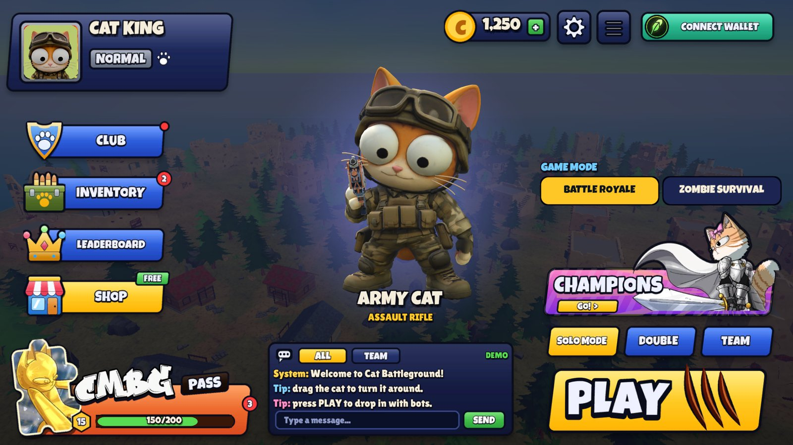

## The game

- **Battle Royale**: 10 cats drop from a plane onto an island, parachute in, fight inside a shrinking storm zone. Last cat standing wins.
- **Zombie Survival**: endless waves of zombie cats in a walled town; runners, tanks and a boss every 5th wave.
- Third-person shooter controls (PUBG / Fortnite style): free orbit camera, shoulder aim, sniper scope, crouch, jump, bombs with a predicted throw arc.
- One fixed weapon per character, so the cat you own decides how you play.
- Plays on desktop **and phones** (touch controls with a customisable layout).
- **Online leaderboard** (weekly + all time, Battle Royale and Zombies). Only matches played with a connected wallet are ranked.
- Current beta runs fully in the browser against AI opponents; the netcode for online matches (dedicated server over WebSocket) is already in the codebase.

<p>
  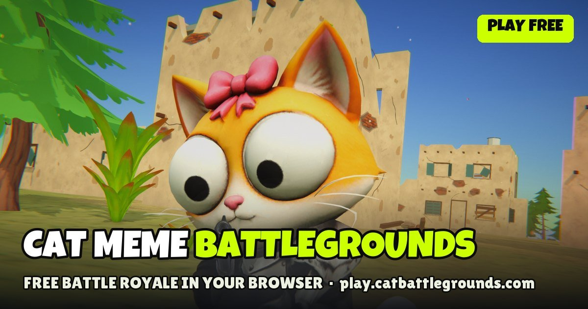
  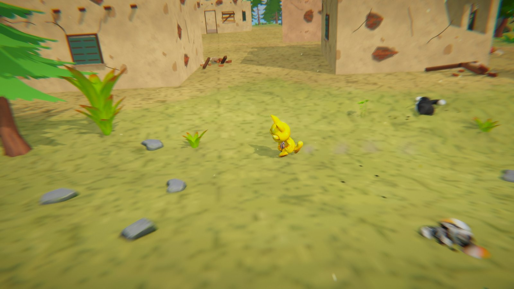
</p>

## Characters

Nine playable cats. Army Cat is free for everyone; the others are unlocked with a pass card NFT.

| | | |
|:-:|:-:|:-:|
| 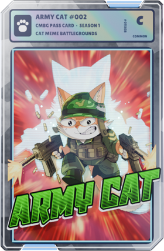<br>**Army Cat** · Original (free)<br>Assault Rifle | 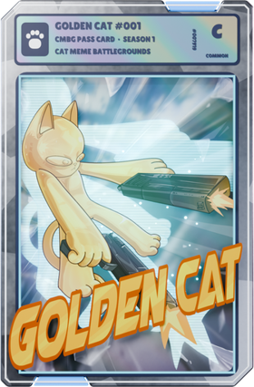<br>**Golden Cat** · Common<br>Light Machine Gun | 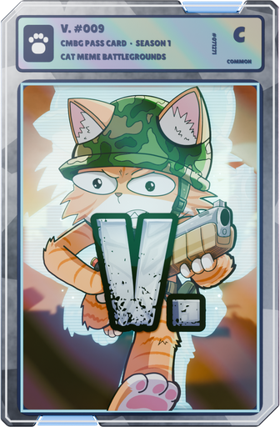<br>**V.** · Common<br>Heavy Rifle |
| 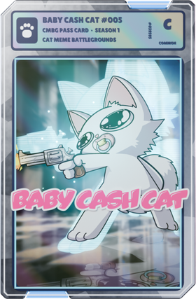<br>**Baby Cash Cat** · Common<br>Burst Pistol | 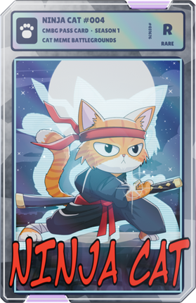<br>**Ninja Cat** · Rare<br>Sniper | 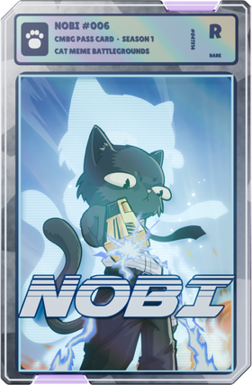<br>**Nobi** · Rare<br>Rapid SMG |
| 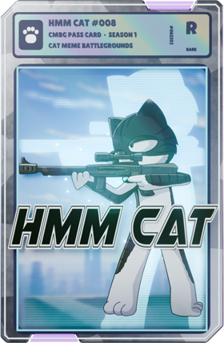<br>**Hmm Cat** · Rare<br>Silent Carbine | 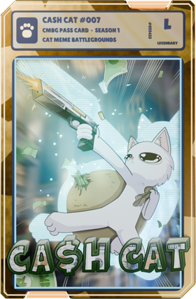<br>**Cash Cat** · Legendary<br>Golden Cash Sniper | 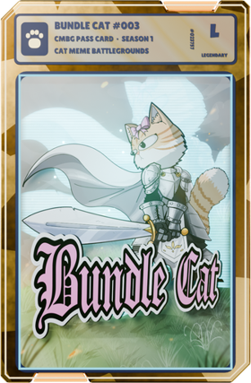<br>**Bundle Cat** · Legendary<br>Combat Shotgun |

## Web3: pass cards

1. **Snapshot** of $CMBG holders (taken 8 Nov 2026, 13:00 UTC). Thresholds 150K / 500K / 1M CMBG -> Common / Rare / Legendary, up to 2 cards per wallet, stored as a Merkle root.
2. Holders **claim** a sealed tier card (ERC-721) on the website.
3. The card is **opened** on the website: a random character of that tier is drawn on-chain and written into the token (the metadata switches from the sealed pack to the character), with a pack-opening film.
4. The game reads the wallet's opened cards straight from the chain and lets the player use those cats.

| Contract (Robinhood Chain mainnet) | Address |
|---|---|
| CMBGPassCard (ERC-721 Enumerable, ERC-2981, ERC-4906) | `0x2bD993948bd2A202B0d8904062fadf6f521Fb533` |
| HashChainRandomSource | `0xB672391FC5bAa31eA900C3158623655a8583282c` |
| $CMBG token | `0x5031600A85A0176d440f2662bCa3190E025f1A2f` |

Source verified on Sourcify. Spec and cost estimate: [`contracts/SPEC.md`](contracts/SPEC.md), [`contracts/COSTS.md`](contracts/COSTS.md).

## Tech stack

```
 Browser (WebGL, desktop + mobile)            Cloudflare Workers                 Robinhood Chain
 ┌───────────────────────────────┐    ┌──────────────────────────────┐    ┌──────────────────────┐
 │ Unity 6 (URP) game client     │───▶│ leaderboard  (Worker + D1)   │    │ CMBGPassCard (721)   │
 │ Netcode for GameObjects 2     │    │ chain read proxy (eth_call)  │───▶│ HashChainRandomSource│
 │ wallet: injected / WalletConn.│───▶│ reveal service (cron)        │───▶│ $CMBG token          │
 └───────────────────────────────┘    │ play.catbattlegrounds.com    │    └──────────────────────┘
 Website (HTML/JS, ethers v6) ───────▶│ static hosting               │
                                      └──────────────────────────────┘
```

| Part | Tech |
|---|---|
| Game client | Unity 6 (6000.5), URP, C#, Netcode for GameObjects, WebGL (Brotli, IL2CPP) |
| Smart contracts | Solidity 0.8.28, OpenZeppelin 5, Hardhat (tests in `contracts/test`) |
| Backend | Cloudflare Workers + D1 (leaderboard, anti-cheat checks, chain read proxy, auto-reveal) |
| Website | Plain HTML / CSS / JS, ethers 6 |
| Content pipeline | Blender (Python automation for characters, animations, cards), procedural audio |

## Repository layout

| Folder | Contents |
|---|---|
| `game/Assets/Scripts` | Game code: player, combat, match / zone, bots, zombies, UI, Web3, online |
| `game/Assets/Editor` | Editor tools that build the arena, prefabs, animators and the WebGL build |
| `game/Assets/Shaders` | Custom URP shaders (foliage wind, zone wall) |
| `contracts/` | Pass-card contracts, tests, deploy / admin / snapshot scripts |
| `backend/` | Cloudflare Workers: `leaderboard`, `reveal`, `play` (game hosting) |
| `website/` | Website and pass-card page code |
| `docs/` | Images for this README |

This repository holds the **code** only. 3D models, animations, textures, audio and source art files are kept private and are
not included, so the Unity project here does not open as a complete game; the live build at https://play.catbattlegrounds.com
shows the result.

## Status

- ✅ Browser beta live (Battle Royale vs AI, Zombie Survival), desktop + mobile
- ✅ Online leaderboard live
- ✅ Pass-card contracts live on mainnet, snapshot taken, claim + open live on the website
- 🔜 Online multiplayer servers (EU + US), duo / squad modes, more characters and weapons, mobile app store release

---
© 2026 Cat Meme Battlegrounds. All rights reserved. See [LICENSE](LICENSE).
